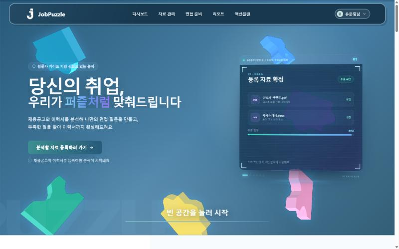
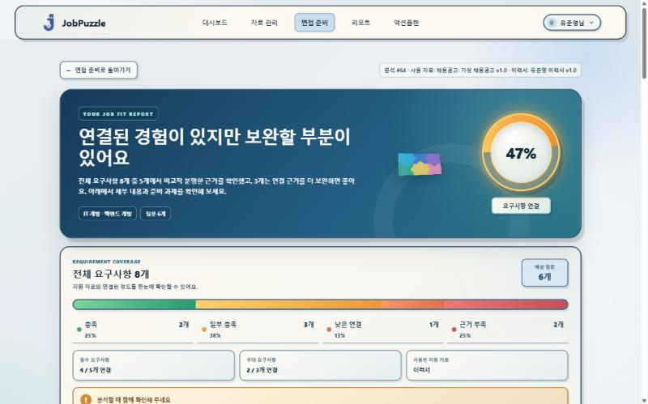
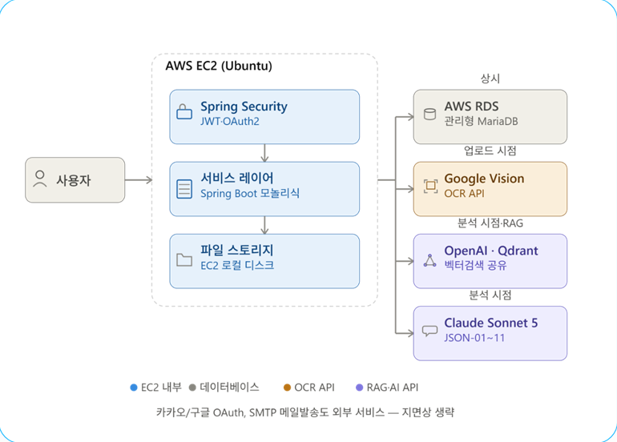

# JobPuzzle — 채용 공고와 내 자료를 근거로 연결하는 AI 면접 준비 서비스

> 채용 공고와 이력서·자소서를 함께 분석해 **요구사항마다 내 자료의 어떤 문장이 근거인지** 보여 주고,
> 부족한 부분은 과제로, 연결된 경험은 맞춤 면접 질문으로 이어 주는 서비스

| | |
|---|---|
| 기간 | 2026.06.30 ~ 08.05 (국비 교육 팀 프로젝트) · 이후 개인 개선 |
| 인원 | 4명 — 홍은표(팀장), 김지혜, 유준영, 이명균 |
| 배포 | AWS EC2 + RDS |

## 목차
1. [기획 배경](#기획-배경)
2. [화면](#화면)
3. [주요 기능](#주요-기능)
4. [아키텍처](#아키텍처)
5. [기술 스택](#기술-스택)
6. [팀 구성과 역할](#팀-구성과-역할)
7. [내가 맡은 기능](#내가-맡은-기능)
8. [주요 개선](#주요-개선)
9. [테스트](#테스트)
10. [실행 방법](#실행-방법)
11. [패키지 구조](#패키지-구조)

---

## 기획 배경
화상 면접 연습, 자소서 첨삭처럼 **기능별** AI 취업 서비스는 많지만, **특정 채용 공고와 내 자료를 함께 분석해 준비 상태를 진단**해 주는 서비스는 부족했습니다.
또 대부분 점수·코멘트만 주고 **무엇을 근거로 평가했는지**는 보여 주지 않습니다.

JobPuzzle은 공고의 요구사항마다 내 자료에서 근거 문장을 찾아 연결하고, 근거가 없으면 지어내지 않고 "근거 부족"으로 표시합니다.

## 화면

**메인**



**분석 결과 — 요구사항 연결도**



**요구사항별 근거 — 어떤 자료의 어떤 문장으로 판단했는지**


## 주요 기능
자료 등록 → 진단 → 면접 → 평가 → 리포트로 이어지는 흐름입니다.

| 단계 | 내용 |
|---|---|
| 자료 등록 | 채용 공고·이력서·자소서·포트폴리오·경험 노트 업로드, PDF 텍스트 추출·OCR, 확정 버전 관리 |
| 적합도 진단 | 공고 요구사항별 연결도(충족·일부·낮음·근거 부족), **근거 문장·자료 위치 표시**, 보완 과제 생성 |
| 3가지 면접 모드 | 기본(직무 기반) · 맞춤(공고·자료 연결) · 약점 보완(이전 평가의 약점 재연습) |
| 답변 평가·리포트 | 관점별 점수, 약점 태그, 다음 연습 추천 |
| 관리자 | 회원 관리, 직무 분류, 직무 가이드 문서 등록·검수·임베딩, AI 호출·오류 로그 조회 |

## 아키텍처



- 분석은 **공고 분석(JSON-01) → 자료 분석(JSON-02) → 직무 가이드 검색(JSON-04) → 맞춤 종합(JSON-05)** 단계로 나뉘고, 단계마다 결과를 저장해 실패한 단계만 다시 실행합니다.
- AI가 돌려줄 결과 형식을 JSON 구조 정의서로 먼저 정하고, 같은 형식을 돌려주는 **Mock AI**로 실제 AI 연동 전에도 팀이 병렬로 개발했습니다.

## 기술 스택

| 구분 | 기술 |
|---|---|
| Backend | Java 21, Spring Boot 3.5, Spring Data JPA, Spring Security (JWT, OAuth2 카카오·구글) |
| AI | Anthropic Claude Sonnet 5 (분석·질문·평가·리포트), OpenAI `text-embedding-3-small` (임베딩), Mock AI |
| Data | MariaDB, Qdrant (벡터 DB) |
| 외부 API | Google Vision (OCR), SMTP (메일) |
| Frontend | Thymeleaf, HTML, CSS, JavaScript |
| Infra · Test | AWS EC2, RDS, Docker, JUnit 5, MockMvc, Testcontainers |

## 팀 구성과 역할

| 이름 | 담당 |
|---|---|
| 홍은표 (팀장) | 자료 등록·OCR·PDF 추출, 다중 이미지 업로드·파일 저장, 분석 입력 스냅샷, 최종 리포트, 관리자 페이지, 배포·인프라 |
| 김지혜 | 로고 디자인, 로그인·회원가입, 소셜 로그인, ERD 정리, 제안서·발표 자료 |
| **유준영** | 전체 서비스 설계, **AI 결과 JSON 구조 정의서**·기능 정의서, **AI 분석 파이프라인**, 액션플랜, 로그인 이후 공통 UI, **직무 가이드 임베딩·RAG** |
| 이명균 | 메인 랜딩·공통 헤더 UI, AI 모의면접 세션·질문·답변 평가, 3가지 면접 모드 연동, 답변 점수 집계·약점 이력 |

## 내가 맡은 기능

### AI 결과 JSON 구조 정의서 + Mock AI
- AI가 단계마다 돌려줄 결과 JSON(12개)의 필드·자료형·규칙을 정의서로 먼저 정하고, 그대로 응답하는 Mock AI를 만들어 **실제 AI 연동 전에도 팀원들이 병렬로 개발**할 수 있게 했습니다.
- 팀원들과 정의서를 함께 확인하며 v13까지 다듬었습니다.

### AI 분석 파이프라인 — "AI가 판단하고, 서버가 확인한다"
- **근거 확인**: AI는 근거의 위치(ID)만 고르고, 실제 문장은 서버가 원문에서 채웁니다 → AI가 원문에 없는 근거를 지어내지 못합니다.
- **검증 범위 조정**: AI가 고르는 것(요구사항 ID·중복·누락)은 엄격하게, 서버가 이미 아는 원문은 서버가 채우도록 나눠, 8번 연속 실패하던 맞춤 분석을 **18회 호출 재시도 0회**로 안정화했습니다.
- **트랜잭션 3단계**: 분석 선점 → AI 호출 → 결과 확정으로 나눠, 수십 초 걸리는 AI 호출 동안 DB 트랜잭션·잠금을 잡지 않습니다. 같은 분석이 겹치면 한 번만 실행하고, 멈춘 실행은 실패로 정리합니다.

### 직무 가이드 임베딩·RAG
- 직무 가이드와 지원 자료를 나눠 Qdrant에 색인하고, **사용자별로 검색 범위를 나눠** 다른 사람의 자료가 섞이지 않게 했습니다.

---

## 주요 개선
프로젝트 종료 후, 실제 API로 분석을 돌려 측정하면서 찾은 문제를 개선했습니다.

### 1. 분석 실행 요청(`/run`) 비동기 전환 → [상세](portfolio-docs/async-analysis-run.md)
화면은 비동기처럼 보였지만 서버의 `/run`은 **분석이 끝날 때까지 HTTP 요청 스레드를 붙잡고** 있었습니다.
접수(소유권·빠른 사전검사)만 하고 202로 응답하도록 바꾸고, 분석은 전용 스레드 풀에서 실행합니다.

| 실제 API 측정 (공고 2쪽 + 이력서 8쪽) | 값 |
|---|---|
| 분석 완료까지 | 3분 29초 |
| `/run` 응답 | **164ms** |
| 분석 중 `/status` 응답 | 최대 63ms |

### 2. 실측으로 찾은 병목 — 자료 분석 병렬화 → [상세](portfolio-docs/measurement-driven-improvements.md)
단계별 시간을 재 보니 **자료 분석이 전체의 68% 차지**했고, 긴 이력서를 나눈 호출을 하나씩 순서대로 실행하고 있었습니다. 서로 독립적인 호출이라 3개씩 동시에 실행하도록 바꿨습니다.

| 같은 입력으로 비교 (실제 API) | 수정 전 | 수정 후 |
|---|---|---|
| 자료 분석 | 141초 | **49초** |
| 분석 전체 | 209초 | **120초** |
| 공고 분석 · 맞춤 종합 | 27초 · 36초 | 26초 · 39초 (변화 없음) |

같은 입력이면 저장된 결과를 재사용하는 구조라, 비교할 때는 재사용을 막고 두 실행의 입력 토큰이 같은지까지 확인했습니다.

### 3. 자격요건 없는 공고를 "AI 오류"가 아닌 입력 문제로 → [상세](portfolio-docs/measurement-driven-improvements.md#2-자격요건-없는-공고를-ai-오류가-아닌-입력-문제로-처리)
실제 실행에서, 자격요건이 없는 공고는 AI가 정상 응답해도 화면에 "AI 요청 실패"로 보이고 자료 분석 비용까지 쓰이고 있었습니다 (Mock으로는 드러나지 않는 문제).
공고 분석 직후 멈추고 "공고에서 자격요건을 찾지 못했어요"로 안내하며, 같은 공고로 다시 실행해도 AI를 부르지 않습니다.

---

## 테스트
전체 **383개 통과** (JUnit 5, MockMvc, Testcontainers)

| 측정 테스트 | 내용 | 실행 조건 |
|---|---|---|
| `AnalysisRunLatencyMeasurementTest` | Mock AI 지연으로 `/run` 응답·요청 스레드 점유 측정 | `LOCAL_DB_MEASURE=true` |
| `Json02PartitionConcurrencyMeasurementTest` | 자료 분석 조각 동시 실행 측정 | `LOCAL_DB_MEASURE=true` |
| `RealAnalysisRunMeasurementTest` | 실제 API로 분석 1건 측정 | `REAL_AI_MEASURE=true` |
| `RealUserFlowMeasurementTest` | PDF 업로드부터 실제 사용자 흐름 전체 측정 | `REAL_AI_MEASURE=true` |

측정 테스트는 로컬 DB·유료 API가 필요해 평소 테스트에서는 실행되지 않습니다. 테스트 실행 시 AI는 Mock으로 고정됩니다(`build.gradle`).

```bash
./gradlew test
```

## 실행 방법

**필요 환경**: Java 21, MariaDB (선택: Docker로 Qdrant)

기본값은 외부 AI 없이 동작하도록 **Mock AI + 메모리 검색(fake RAG)** 입니다.

| 환경변수 | 설명 | 기본값 |
|---|---|---|
| `DB_URL` · `DB_USERNAME` · `DB_PASSWORD` | MariaDB 접속 정보 | `jdbc:mariadb://localhost:3306/jobpuzzle` |
| `AI_GENERATION_DEFAULT_PROVIDER` | `mock` 또는 `anthropic` | `mock` |
| `ANTHROPIC_API_KEY` | 실제 Claude 사용 시 | — |
| `RAG_MODE` | `fake` 또는 `real` | `fake` |
| `OPENAI_API_KEY` · `QDRANT_URL` | `RAG_MODE=real`일 때 임베딩·벡터 검색 | — |
| `MAIL_USERNAME` · `MAIL_PASSWORD` | 메일 인증 | — |
| `KAKAO_CLIENT_ID` · `GOOGLE_CLIENT_ID` 등 | 소셜 로그인 | — |

- OCR용 Google Vision 서비스 계정 파일을 `./credentials/google-vision-service-account.json`에 둬야 앱이 시작됩니다.

```bash
./gradlew bootRun
# http://localhost:8080/jobpuzzle
```

## 패키지 구조
```
com.example.jobpuzzle
├── analysis        # 분석 작업·파이프라인 (controller, service, rag, synthesis, entity, repository)
├── ai              # AI 클라이언트(Claude·Mock), 프롬프트, 응답 검증, 호출 로그
├── document        # 자료 등록·PDF 추출·OCR·버전 관리
├── guide           # 직무 가이드 문서·검색
├── interview       # 모의 면접 세션
├── evaluation      # 답변 평가
├── report          # 최종 리포트
├── jobposting · jobcategory · questiontemplate
├── admin · user
└── global          # 공통 설정·보안·예외·비동기 실행기
```
